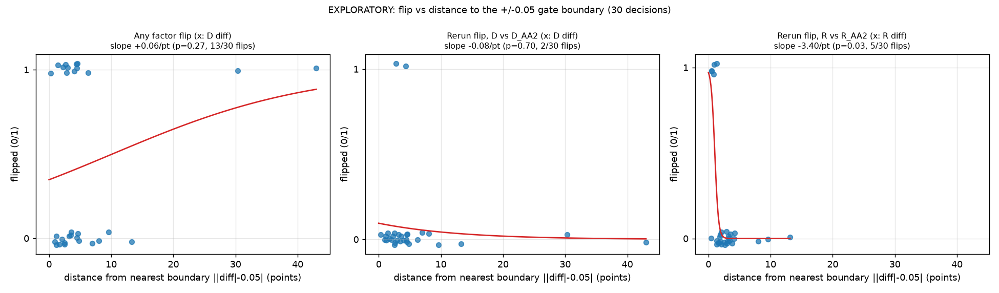

**EXPLORATORY, post hoc. Not pre-registered. Existing data only (analysis at tag pre-analysis-v2.2, commit 8e68388); descriptive; feeds no gate, verdict or hypothesis.**

# Flip vs distance to the gate boundary

For each of the 30 decisions: distance = ||stress diff| - 0.05| (percentage points; the point gate changes label at +/-0.05). 'Any factor' = flips under at least one of F1-F10 (P1's definition, main variants); 'generation' = F1-F6, F11. Rerun flips are point-gate label changes, D vs D_AA2 and R vs R_AA2. Logistic fit of flip ~ distance (points), unpenalised.

| Outcome | Flips / decisions | Slope per point | SE | p |
|---|---|---|---|---|
| any factor (D diff) | 13/30 | +0.062 | 0.056 | 0.269 |
| generation factor (D diff) | 15/30 | +0.102 | 0.089 | 0.252 |
| rerun D vs D_AA2 (D diff) | 2/30 | -0.084 | 0.222 | 0.703 |
| rerun R vs R_AA2 (R diff) | 5/30 | -3.404 | 1.555 | 0.029 |

| Distance from boundary (D diff) | Decisions | Any-factor flips | Rerun flips (D) |
|---|---|---|---|
| 0-1 pts | 2 | 1 | 0 |
| 1-2 pts | 4 | 1 | 0 |
| 2-5 pts | 17 | 8 | 2 |
| 5-+ pts | 7 | 3 | 0 |

**Caveat:** 30 decisions with at most 13 events, so the fits are crude and a non-significant slope does not show there is none; decisions are not independent (pairs share models). A negative slope means flips concentrate near the boundary. The R rerun fit is close to separation (all 5 flips lie within about 1.5 points of a boundary), so its slope and p-value are unstable; read it as "R rerun flips occurred only very near a boundary", not as an effect size.
